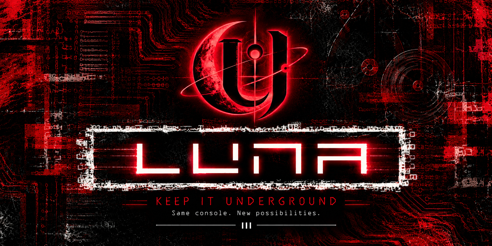

<p align="center">
  
  <br>
  <sub>LIMEN UMBRAE NEXUS ARCANUM</sub>
</p>

Built upon [NHDDL](https://github.com/pcm720/nhddl), it offers a different vision. Rooted in familiar foundations.

ISOs launch through [Neutrino](https://github.com/rickgaiser/neutrino) or [OPL](https://github.com/ps2homebrew/Open-PS2-Loader). VCDs launch through [PSXCore](https://github.com/dnunezx/PSXCore).

<details>
<summary><strong>0x01 // Library v̶ie̶w̸s</strong></summary>


| View | Experience |
| --- | --- |
| List | A title list with a cover and spinning disc label. Choose Separate or Overlap artwork. |
| Collections | A PSBBN-inspired cover flow using square artwork. |
| Orbit | A rotating ring of covers with perspective, depth, and Random Scan. |
| 3D | A 6 × 4 display of game cases with a selected-cover preview and PS1 jewel-case styling. |
| Scroll | A horizontal logo strip above a cover carousel. Missing logos fall back to title text. |


</details>

<details>
<summary><strong>0x02 // R̷equir̶e̶men̷ts̸</strong></summary>


- PlayStation 2: hardware testing has been performed on a fat PS2.
- Free McBoot memory card: enough space for the complete `APP_LUNA` folder.
- Internal ATA/exFAT HDD: the intended setup for library and artwork performance, with an MBR or GPT partition table and an exFAT partition.
- Compatible network adapter or HDD bridge: hardware testing used a GameStar PS2 SATA HDD Adapter.
- Optional artwork: games can launch without it. Use [OrbitPS2 Manager — LUNA Edition](https://github.com/dnunezx/OrbitPS2-Manager-LUNA-edition) to prepare the library and artwork.

Other storage sources are selectable through Start → Storage Devices. Artwork performance on slower devices can affect navigation.


</details>

<details>
<summary><strong>0x03 // Installation</strong></summary>


These steps use a memory card in slot 1 (`mc0:`), a working FMCB setup, and a USB drive your PS2 can read.

1. Download the package ending in `-FMCB-mc0.zip` from [LUNA Releases](https://github.com/dnunezx/LUNA/releases).
2. Extract it and copy the complete `APP_LUNA` folder to the USB drive's root.
3. On the PS2, open uLaunchELF or wLaunchELF from FMCB. Copy `APP_LUNA` from `mass:/` to `mc0:/`.
4. Open FMCB Configurator, add a menu item named LUNA, and set its path to `mc0:/APP_LUNA/luna.elf`. Save the FMCB configuration.
5. Connect the prepared game drive and start LUNA from FMCB.

Keep the application folder intact:

```text
mc0:/APP_LUNA/
  luna.elf
  luna.yaml
  neutrino.elf
  config/
  modules/
```

### // Optional ambient music


If your release includes `Ambient-Music-Add-On`, copy its `ambient.wav` file into `APP_LUNA`. It uses about 1.3 MB of additional card space. Enable Options → Global → Ambient sound, then press Start to save. LUNA also works without the music file.


</details>

<details>
<summary><strong>0x04 // Preparing y̷o̶u̷r̸ library</strong></summary>


```text
/CD/                         PS2 CD images
/DVD/                        PS2 DVD images
/VCD/                        PS1 VCD images
/ART/                        Cover and disc artwork
/ART/PSBBN/                  Square artwork
/ART/SCROLL/                 Scroll logos
/CHT/                        Raw PS2RD cheat files
/VMC/                        PS2 virtual memory cards
/LUNA/                       Library state and settings
```

### SYS_01 // PlayStation setup


PS1 discovery and launch preparation support internal ATA and USB drives. Place compatible `.VCD` images in `VCD/` on the game drive. Supply the exact firmware files accepted by the bundled PSXCore version on that same drive:

```text
/POPS/POPS.ELF
/POPS/IOPRP252.IMG
```

Sony's POPS runtime is proprietary and is not included. LUNA checks the firmware's size and SHA-256 before launch and reports missing or mismatched files. Keep `psxcore-runtime-bootstrap.elf` beside `neutrino.elf` in `APP_LUNA`.

Press L3 to choose Mix or PS1, select a game, and press Cross. Missing default cards are created automatically. The default pair is shared; choose a named pair in the game's memory-card settings for separate saves.

<a name="multi-disc-games"></a>


### SYS_02 // Multi-disc games


A disc set combines two to four VCD images into one library entry. Keep every image on the same drive and arrange them in the game's disc order.

<a name="create-a-set-in-luna"></a>


### SYS_03 // Create a set in LUNA


1. Highlight one of the game's discs and open Triangle → Game → Discs.
2. Select Manage discs. LUNA can suggest nearby images with matching names such as `Game (Disc 1).VCD` and `Game (Disc 2).VCD`.
3. Check the suggestion. Use Add disc for missing images. Select an entry to Move earlier, Move later, or Remove disc. The first entry is Disc 1.
4. Choose Save disc set, enter a name when creating a new set, and confirm. LUNA saves an `.m3u` playlist and refreshes the library. If prompted, refresh the drive through Start → Storage Devices.
5. Highlight the grouped entry. Under Game → Discs → Start disc, choose the disc to boot and press Start to save. Return to the library and press Cross to launch.


### SYS_04 // Swap discs during play


Launch the grouped entry so PSXCore receives the complete set. When the game asks you to change discs, use controller port 1:

| Hold together | Selects |
| --- | --- |
| L2 + R2 + Select + Up | Disc 1 |
| L2 + R2 + Select + Right | Disc 2 |
| L2 + R2 + Select + Down | Disc 3 |
| L2 + R2 + Select + Left | Disc 4 |

Release all buttons before entering a shortcut, then release them again after selecting the disc so the swap can finish. Follow the game's on-screen prompts. Only discs registered in the launched set are available. These shortcuts follow [PSXCore's disc-swap controls](https://github.com/dnunezx/PSXCore). This changes the disc in the running game; it does not launch an unrelated game from your library.


</details>

<details>
<summary><strong>0x05 // Controls</strong></summary>


| Button | Library action |
| --- | --- |
| Cross | Launch the selected game. |
| Circle | Switch to the next enabled view. |
| Triangle | Open Options. |
| Start | Open the main menu. |
| Select | Switch between All and Favorites. |
| L3 | Cycle Mix → PS2 → PS1 in PSXCore-enabled builds. |
| Hold R1 | Open the quick menu. |
| Square in List | Add or remove the selected Favorite. |
| Square in Orbit | Start Random Scan; navigation cancels it. |
| L2 / R2 in List or 3D | Move between pages. |
| Hold L2 / R2 in Collections | Fast scan through covers. |

While holding R1, use Cross to toggle the Favorites filter, Circle to toggle the selected Favorite, Triangle for Options, L3 for the platform filter, or R3 for Orbit Random Scan.

### SYS_05 // In-game return


```text
L1 + L2 + R1 + R2 + Start + Select
```


### SYS_06 // PlayStation


Use the default shared cards on the game drive, or create and assign a named pair through the game's memory-card settings. Both slots follow the selected pair. Press Start in game settings to save the assignment.

```text
/POPS/ps1emu/card0              Default shared slot 1
/POPS/ps1emu/card1              Default shared slot 2
/POPS/CARDS/<name>/card0.vmc     Named pair, slot 1
/POPS/CARDS/<name>/card1.vmc     Named pair, slot 2
```

Each card is 128 KB. The manager supports import, export, backups of both cards, and recovery of interrupted card operations. Importing into a shared card affects every game using it. These management features are part of the experimental PS1 integration; real-game save/reload testing remains ongoing.


</details>

<details>
<summary><strong>0x0S // S̷t̸o̶r̷a̸g̶e̷</strong></summary>

**MMCE Game ID switching:** enable the existing option in **Start → Storage Devices**
to select per-game cards on compatible MMCE devices. It is off by default and does
not require MMCE to be enabled as a library source. MX4SIO must be inactive.

The card holding the launcher switches only after the launch files are loaded
and when in-game return is available. In-game return restores switched cards to
their boot cards before LUNA reloads. Physical reset and power-cycle behavior
follow the memory card's own startup configuration.


Start → Storage Devices selects ATA/exFAT HDD, APA/HDLoader HDD, USB, MX4SIO, MMCE, iLink, or UDPFS. Toggle sources and choose Apply changes & scan, rescan one enabled source with Square, or rescan all enabled devices. MX4SIO and MMCE cannot be selected together. UDPFS needs Ethernet and a running server; its console-IP setting is the PS2's address.


</details>

<details>
<summary><strong>0x0A // Artwork</strong></summary>


Artwork is optional. LUNA uses title IDs and these PNG naming conventions:

```text
/ART/<TITLE_ID>_COV.png         Cover artwork
/ART/<TITLE_ID>_ICO.png         Optional disc label
/ART/PSBBN/<TITLE_ID>.png       Square artwork for Collections and Orbit
/ART/SCROLL/<TITLE_ID>_LGO.png  Optional Scroll logo
```

</details>

<details>
<summary><strong>0x0C// C̷r̸e̶d̷i̸t̶s̷</strong></summary>


LUNA builds on years of work by the PlayStation 2 homebrew community.

**LUNA and PSXCore:** Danny Nunez ([dnunezx](https://github.com/dnunezx)), 2026. Existing upstream authorship and license notices remain with their respective projects.

**NHDDL:** Ivan V ([pcm720](https://github.com/pcm720)), whose [NHDDL](https://github.com/pcm720/nhddl) provides the foundation for LUNA’s frontend.

**Neutrino:** Rick Gaiser (Maximus32 / [ps2max32](https://github.com/ps2max32)) and contributors, for the [Neutrino](https://github.com/ps2max32/neutrino) game runtime and associated driver work, including network transports and MX4SIO contributions.

### Open PS2 Loader


Special thanks to **[Ifcaro](https://github.com/ifcaro) and [jimmikaelkael](https://github.com/jimmikaelkael)**, OPL’s original developers, and **[Polo / polo35](https://github.com/ps2homebrew/Open-PS2-Loader/blob/master/CREDITS)**, whose HD Project formed its original code foundation.

We also acknowledge **[volca, izdubar, hominem.te.esse, BatRastard, crazyc, dlanor, doctorxyz, and reprep](https://github.com/ps2homebrew/Open-PS2-Loader/blob/master/CREDITS)**; **[belek666](https://github.com/belek666)**; the contributors credited elsewhere in this section; and the wider OPL development, testing, and maintenance community.

LUNA uses OPL game-core code and preserves its upstream attribution.

**Active upstream:** [Open PS2 Loader — ps2homebrew](https://github.com/ps2homebrew/Open-PS2-Loader)

**Full acknowledgements:** [Official OPL credits](https://github.com/ps2homebrew/Open-PS2-Loader/blob/master/CREDITS)


### Drivers, filesystems, and libraries


**[ps2dev / PS2SDK contributors:](https://github.com/ps2dev/ps2sdk)** The development foundation and drivers for storage, filesystems, controllers, memory cards, networking, and audio.

**[Marcus R. Brown:](https://github.com/ps2homebrew/Open-PS2-Loader/blob/master/CREDITS)** Original DEV9 and ATAD driver work and related code inherited through PS2SDK and OPL.

**[SP193:](https://github.com/sp193)** iLink driver work, alongside contributions to OPL and PS2SDK.

**[MMCE authors and contributors:](https://github.com/ps2-mmce/mmceman)** MMCEMAN and the MMCE driver family used for compatible memory-card devices.

**[Warksmith:](https://github.com/Warksmith)** MMCE Game ID integration, timer-independent polling, and launcher boot-card protection.

**[Wisi:](https://github.com/wisi-w)** SIO2 research and documentation, and original MX4SIO work.

**[ChaN — FatFs:](https://elm-chan.org/fsw/ff/)** The FAT/exFAT filesystem library used through PS2SDK.

**[Mathias Lafeldt (misfire):](https://github.com/mlafeldt)** Cheat-engine code inherited through Neutrino and OPL, and OPL contributions.

**[gsKit / dmaKit contributors:](https://github.com/ps2dev/gsKit)** Graphics and DMA libraries.

**[libpng](https://www.libpng.org/pub/png/libpng.html), [zlib](https://zlib.net/), and [libtiff](https://libtiff.gitlab.io/libtiff/) contributors:** Image and compression libraries used by LUNA’s graphics dependencies.


### Design, assets, and community


**[CosmicScale](https://github.com/CosmicScale) and the [PSBBN Definitive Project:](https://github.com/CosmicScale/PSBBN-Definitive-Project)** Design inspiration and assets.

**[NathanNeurotic (Ripto):](https://github.com/NathanNeurotic)** Help with ambient orbs.

**[aap:](https://github.com/aap/osdbits)** OSDSYS reverse engineering.

**[Kenney:](https://www.kenney.nl/)** CC0 input-prompt assets.

Thank you to all LUNA beta testers and the wider PS2 homebrew community.

See [AUTHORS.md](https://github.com/dnunezx/LUNA/blob/main/AUTHORS.md), [UPSTREAM.md](https://github.com/dnunezx/LUNA/blob/main/UPSTREAM.md), the preserved licenses in [LICENSES](https://github.com/dnunezx/LUNA/tree/main/LICENSES), and individual dependency notices for further attribution and source lineage.

Games, Sony firmware, and proprietary POPS runtime files are not distributed in this source repository.


</details>
