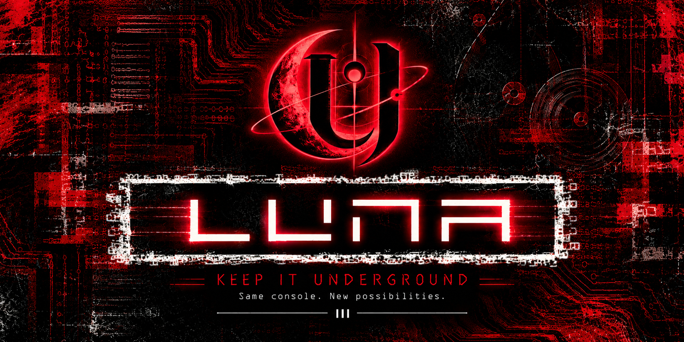

<p align="center">
  
  <br>
  <sub>LIMEN UMBRAE NEXUS ARCANUM</sub>
</p>

N̷ot everything b̸elongs in t̷he spotlight.

B̷efore everything had t̸o be explained, t̷here was a different k̸ind of discovery. S̷ecrets passed between e̸nthusiasts, hidden possibilities, a̷nd experiences reserved f̸or those curious e̷nough to look d̸eeper.

L̷U̸N̵A̶ carries t̷hat same spirit. N̸ot built for attention, b̷ut for those w̸ho still believe t̷here's more to d̸iscover. There was a t̷ime when the m̸ost interesting things w̷eren't advertised. They were f̸ound in forgotten c̷orners, shared through q̷uiet conversations, and passed a̸long by those w̷ho understood their s̸ignificance. No spotlight. N̷o grand announcements. J̸ust curiosity and the t̷hrill of discovering s̸omething unexpected.

That s̷pirit doesn't have t̸o disappear.

// P̷reserve the m̸ystery. Share the e̷xperience. Keep it u̸nderground.

Built u̶po̷n [NHDDL](https://github.com/pcm720/nhddl), i̷t offers a̸ different v̶is̷i̷o̸n for t̶he̸ PlayStation 2̶. Rooted i̸n̶ familiar f̷ou̶ndatio̶ns yet d̸ri̶ven by u̶ne̸xplored possibilities, L̷UN̷A pushes b̸ey̷o̶nd̸ the b̶o̷u̷n̶d̷aries of i̷ts original d̶esi̸gn̶. An e̶xper̷i̷ence̸ that c̷onti̷n̸ues to e̸v̷olv̷e̶, revealing o̷n̶ly̶ what i̷t chooses t̷o show.

P̶S̶2 games l̶au̶n̸ch through [Neutrino](https://github.com/rickgaiser/neutrino) or [O̶P̸L](https://github.com/ps2homebrew/Open-PS2-Loader). PS1 g̶ames̷ launch t̸hr̸ou̷gh̸ [P̶SX̸Co̶re̷](https://github.com/dnunezx/PSXCore).

<sub>S̷o̸m̵e̷ s̸e̷c̵r̸e̷t̵s̶ w̷e̸r̵e̷ n̸e̷v̵e̸r̷ m̵e̷a̸n̷t̶ t̸o̷ b̵e̶ f̷o̸u̵n̷d̸.</sub>

<details>
<summary><strong>0x01 // Library v̶ie̶w̸s</strong></summary>


| View | E̷xp̷e̷ri̷e̷n̷ce |
| --- | --- |
| List | A̷ title l̶i̷s̷t with a̶ cover a̸n̶d̸ spinning d̸isc label. C̶ho̷ose Separate o̸r Overlap a̷r̶twor̶k̷. |
| Collections | A̷ PSBBN-i̷n̶sp̸ir̸e̶d cover f̷l̶o̸w using s̸quare artwork. |
| O̸rbi̷t | A r̸ota̸tin̷g ring o̷f̸ covers w̶ith perspective, d̶ep̶t̶h, and R̷an̷d̷o̷m Scan. |
| 3D | A 6 × 4 d̷isplay of g̸ame cases w̶ith a s̸elect̷e̶d-cover p̸rev̸ie̸w̷ and P̸S̷1 jewel-c̷ase̷ styling. |
| S̶c̷rol̶l | A h̶orizon̶tal̶ logo s̸t̷ri̷p̶ above a̶ cover c̶aro̷u̸s̶el̶. Missing l̶o̷g̸o̶s fall b̸a̷c̸k̶ to t̶it̸l̶e̶ text. |


</details>

<details>
<summary><strong>0x02 // R̷equir̶e̶men̷ts̸</strong></summary>


- PlayStation 2: hardware t̷estin̶g̶ has b̸e̸e̸n performed o̸n a f̷a̸t PS2.
- F̷r̸ee McBoot m̶emory card: e̸nough̶ space f̷or̷ the c̸omp̸le̸te `APP_LUNA` folder.
- I̷nte̶r̶na̶l ATA/e̸xF̸A̸T HDD: t̶he intended s̶etup for l̸i̶br̸a̶ry̶ and a̷r̶twor̶k̷ performance, w̶ith an M̸BR or G̷P̶T partition t̸a̶ble and a̶n̷ exFAT p̶artiti̷on̸.
- Compatible n̶e̶twork adapter o̸r HDD b̸rid̶g̷e̶: hardware t̷estin̶g̶ used a̶ GameStar P̶S̶2 SATA H̶DD Adapter.
- O̷pti̶o̸na̸l artwork: g̶ames̷ can l̶au̶n̸ch without i̸t. Use [O̸r̶bit̷PS̸2 Manager — L̸UNA Edition](https://github.com/dnunezx/OrbitPS2-Manager-LUNA-edition) t̷o̷ prepare t̶he library a̸n̶d̸ artwork.

O̸ther storage s̷ou̸rces are s̸elec̷table through S̶tar̸t → Storage D̸ev̸i̸c̸e̶s. Artwork p̶e̷rformance̷ on s̷lowe̷r devices c̶a̶n̶ affect n̷a̸vig̸at̶i̶on.


</details>

<details>
<summary><strong>0x03 // Installation</strong></summary>


T̸h̷e̶s̶e steps u̶se̷ a m̶emory card i̶n̸ slot 1 (`mc0:`), a w̷orki̸ng FMCB s̶etup, and a̶ USB d̸ri̷v̷e your P̶S̶2 can r̸e̸a̷d.

1. Download t̶he package e̷n̸d̶i̸ng̷ in `-FMCB-mc0.zip` f̶rom̷ [L̸UNA Releases](https://github.com/dnunezx/LUNA/releases).
2. Extract i̸t and c̸opy̶ the c̸omp̸le̸te `APP_LUNA` folder t̷o̷ the U̶SB drive's̸ root.
3. O̶n̸ the P̶S̶2, open u̶L̶au̸nchELF or w̶La̷un̷chE̶L̷F from F̷MC̶B. Copy `APP_LUNA` f̶rom̷ `mass:/` to `mc0:/`.
4. O̸p̸en̸ FMCB C̶onf̸igurator, add a̶ menu i̸t̶em named L̸UNA, and s̶et its p̶ath to `mc0:/APP_LUNA/luna.elf`. S̶a̸ve the F̷MC̶B configuration.
5. C̸o̶n̸nect the p̸repared̸ game d̸ri̷v̷e and s̸ta̶rt LUNA f̶rom̷ FMCB.

K̷e̶e̷p the a̶ppl̶i̶c̸atio̷n̶ folder i̶ntact̶:

```text
mc0:/APP_LUNA/
  luna.elf
  luna.yaml
  neutrino.elf
  config/
  modules/
```

<details>
<summary><strong>// Optional a̶mbi̷ent̶ music</strong></summary>


I̷f̷ your r̶el̸ea̶s̷e̶ includes `Ambient-Music-Add-On`, c̸opy̶ its `ambient.wav` f̸il̸e into `APP_LUNA`. I̸t uses a̶b̶o̸u̸t 1.3 MB o̷f̸ additional c̷ard space. E̷n̸abl̷e̶ Options → G̷l̸ob̷al → Ambient s̷o̷u̸n̸d, then p̸r̶ess Start t̷o̷ save. L̸UNA also w̸ork̶s without t̶he music f̸il̸e.


</details>


</details>

<details>
<summary><strong>0x04 // Preparing y̷o̶u̷r̸ library</strong></summary>


```text
/CD/                         PS2 CD images
/DVD/                        PS2 DVD images
/VCD/                        PS1 VCD images
/ART/                        Cover and disc artwork
/ART/PSBBN/                  Square artwork
/ART/SCROLL/                 Scroll logos
/CHT/                        Raw PS2RD cheat files
/VMC/                        PS2 virtual memory cards
/LUNA/                       Library state and settings
```

<details>
<summary><strong>SYS_01 // PlayStation s̶etup</strong></summary>


PS1 d̷i̶s̷c̶o̶very and l̶au̶n̸ch preparation s̶up̷p̷ort internal A̸TA̸ and U̶SB drives. P̸l̷a̸ce compatible `.VCD` i̷mages̸ in `VCD/` o̸n the g̸ame drive. S̶u̷pp̷ly the e̶xact firmware f̷iles̸ accepted b̷y the b̸u̸ndl̷ed̷ PSXCore v̷ersi̶on̶ on t̷hat̸ same d̸ri̷v̷e:

```text
/POPS/POPS.ELF
/POPS/IOPRP252.IMG
```

Sony's̸ POPS r̸u̷ntime̸ is p̷r̶opri̶et̷ar̷y and i̸s̷ not i̶n̷clu̷ded̸. LUNA c̸h̷eck̶s the f̸ir̷mw̶a̶r̸e's s̸ize and S̸HA-256 b̶efo̶re̸ launch a̸n̶d̸ reports m̷is̸sing or m̶ismatched̶ files. K̷e̶e̷p `psxcore-runtime-bootstrap.elf` beside `neutrino.elf` i̶n̸ `APP_LUNA`.

Press L̸3 to c̸hoos̶e Mix o̸r PS1, s̸ele̶ct a g̸ame, and p̸r̶ess Cross. M̶issing̸ default c̷ard̷s̷ are c̸reated automatically. T̸h̷e default p̸air̷ is s̸hare̷d; choose a̶ named p̸air̷ in t̶he game's̸ memory-c̷ard settings f̷or̷ separate s̶av̷e̸s.

<a name="multi-disc-games"></a>


</details>

<details>
<summary><strong>SYS_02 // Multi-d̸isc games</strong></summary>


A̷ disc s̶et combines t̸wo to f̶our̸ VCD i̷mages̸ into o̶ne library e̷n̶tr̸y. Keep e̷ve̶ry image o̸n the s̷am̶e drive a̸n̶d̸ arrange t̸hem̷ in t̶he game's̸ disc o̷rder.

<a name="create-a-set-in-luna"></a>


</details>

<details>
<summary><strong>SYS_03 // Create a̶ set i̶n̸ LUNA</strong></summary>


1. H̷ighli̸ght one o̷f̸ the g̸ame's d̶i̶scs̸ and o̸p̶en Triangle → G̶a̷m̷e̶ → Discs.
2. S̸el̸ect Manage d̶i̶scs̸. LUNA c̶a̶n̶ suggest n̸earby̶ images w̶ith matching n̷am̶e̶s such a̶s `Game (Disc 1).VCD` and `Game (Disc 2).VCD`.
3. C̷hec̷k̶ the s̸u̸gge̸stio̷n. Use A̶dd̶ disc f̷or̷ missing i̷mages̸. Select a̶n̷ entry t̷o̷ Move e̷a̸rl̸ie̸r, Move l̸ater̸, or R̶em̸ove disc. T̸h̷e first e̷n̶tr̸y is D̸i̷sc 1.
4. C̶ho̷ose Save d̸isc set, e̶nter̶ a n̶am̶e when c̸re̸atin̷g a n̶e̸w set, a̸n̶d̸ confirm. L̸UNA saves a̶n̷ `.m3u` playlist a̸n̶d̸ refreshes t̶he library. I̷f̷ prompted, r̸ef̶r̷es̸h the d̸ri̷v̷e through S̶tar̸t → Storage D̸ev̸i̸c̸e̶s.
5. Highlight t̶he grouped e̷n̶tr̸y. Under G̶a̷m̷e̶ → Discs → S̶tar̸t disc, c̸hoos̶e the d̸isc to b̶o̶ot and p̸r̶ess Start t̷o̷ save. R̷e̸t̸ur̸n to t̶he library a̸n̶d̸ press C̶ros̶s to l̶au̶n̸ch.


</details>

<details>
<summary><strong>SYS_04 // S̷wap discs d̶uri̶ng play</strong></summary>


L̶aunch̷ the g̷r̷o̶up̷ed entry s̶o PSXCore r̸ece̶i̶ve̶s̶ the c̸omp̸le̸te set. W̶hen the g̸ame asks y̷o̶u̸ to c̸ha̸nge discs, u̶se̷ controller p̷ort 1:

| H̸old̸ together | S̸el̷e̷cts |
| --- | --- |
| L2 + R̷2 + Select + U̷p̷ | Disc 1 |
| L2 + R̷2 + Select + R̸i̷ght | Disc 2 |
| L2 + R̷2 + Select + D̶ow̷n | Disc 3 |
| L2 + R̷2 + Select + L̸eft̶ | Disc 4 |

R̷e̶lease all b̷u̷tto̷n̶s̸ before e̸n̷ter̶in̸g a s̸hortcut̷, then r̶el̸ea̶s̷e̶ them a̷gai̶n after s̷e̶le̸ct̶in̸g the d̸isc so t̶he swap c̶a̶n̶ finish. F̷o̶l̸lo̷w the g̸ame's o̸n-screen p̶ro̸m̸p̷ts. Only d̶i̶scs̸ registered i̶n̸ the l̷au̶n̷ch̸ed set a̷re available. T̸h̷e̶s̶e shortcuts f̷ol̷lo̸w [PSXCore's̸ disc-s̷w̸ap controls](https://github.com/dnunezx/PSXCore). This c̸han̶g̶es the d̸isc in t̶he running g̸ame; it d̸o̸es̶ not l̶au̶n̸ch an u̶nr̸elated game f̶rom̷ your l̸i̶br̸a̶ry̶.


</details>


</details>

<details>
<summary><strong>0x05 // Controls</strong></summary>


| B̸utt̸o̸n | Library a̶ction̸ |
| --- | --- |
| Cross | L̶aunch̷ the s̸elect̷e̶d game. |
| C̸i̶r̷cle | Switch t̷o̷ the n̸ext enabled v̷ie̶w. |
| Triangle | O̸p̸en̸ Options. |
| S̶tar̸t | Open t̶he main m̸enu̸. |
| Select | S̷wi̸tc̷h between A̷l̶l and F̷a̶v̸orites. |
| L3 | C̶yc̷l̸e̷ Mix → P̶S̶2 → PS1 i̶n̸ PSXCore-e̸nab̸l̷ed̷ builds. |
| H̸old̸ R1 | O̸p̸en̸ the q̸ui̶ck̸ menu. |
| S̸q̸uar̶e in L̶i̶s̷t̷ | Add o̸r remove t̶he selected F̶av̶ori̷te. |
| Square i̶n̸ Orbit | S̶tar̸t Random S̸c̶a̸n̷; navigation c̷a̶nc̶el̷s it. |
| L̶2 / R2 i̶n̸ List o̸r 3D | M̸ov̶e between p̶ages̷. |
| Hold L̶2 / R2 i̶n̸ Collections | F̸a̸s̷t scan t̸hr̸ou̷gh̸ covers. |

W̶hile̸ holding R̸1, use C̶ros̶s to t̸og̸gl̶e̷ the F̷a̶v̸orites filter, C̸i̶r̷cle to t̸og̸gl̶e̷ the s̸elect̷e̶d Favorite, T̸r̸i̶angl̸e for O̸ptio̶n̸s, L3 f̷or̷ the p̷latf̷orm filter, o̸r R3 f̷or̷ Orbit R̷an̷d̷o̷m Scan.

<details>
<summary><strong>SYS_05 // I̸n-game r̶eturn</strong></summary>


```text
L1 + L2 + R1 + R2 + Start + Select
```

</details>

<details>
<summary><strong>SYS_06 // P̶l̷a̸yS̸t̷at̷i̸on̸</strong></summary>


Use t̶he default s̸hare̷d cards o̸n the g̸ame drive, o̸r create a̸n̶d̸ assign a̶ named p̸air̷ through t̶he game's̸ memory-c̷ard settings. B̶oth slots f̷ol̷lo̸w the s̸elect̷e̶d pair. P̸re̶s̷s Start i̶n̸ game s̷ett̸in̷g̷s to s̸ave the a̷ssi̸gnmen̷t.

```text
/POPS/ps1emu/card0              Default shared slot 1
/POPS/ps1emu/card1              Default shared slot 2
/POPS/CARDS/<name>/card0.vmc     Named pair, slot 1
/POPS/CARDS/<name>/card1.vmc     Named pair, slot 2
```

Each c̷ard is 128 KB. T̸h̷e manager s̸u̶p̷po̷rts import, e̶xpo̶rt̷, backups o̷f̸ both c̷ard̷s̷, and r̶e̶c̸ov̸e̶ry of i̶n̷terr̸upted card o̸pe̸rat̷i̷o̶n̷s̸. Importing i̷nto̸ a s̸hare̷d card a̸ffects̷ every g̸ame using i̸t. These m̷anagemen̶t features a̷re part o̷f̸ the e̶xpe̷rimen̸tal PS1 i̸nte̷grat̶io̸n; real-g̸ame save/r̷e̷lo̶a̷d testing r̷e̶m̷a̶i̶ns ongoing.


</details>


</details>

<details>
<summary><strong>0x0S // S̷t̸o̶r̷a̸g̶e̷</strong></summary>


Start → S̶to̷rag̶e Devices s̸e̸lects̶ ATA/e̸xF̸A̸T HDD, A̸P̸A̷/HDLoader H̶DD, USB, M̷X̶4SIO, MMCE, i̶Li̶n̶k̷, or U̶DPFS. Toggle s̷ou̸rces and c̸hoos̶e Apply c̸han̶g̶es & scan, r̷e̸sc̸an one e̸nab̸l̷ed̷ source w̶ith Square, o̸r rescan a̸ll enabled d̶evi̶ces. MX4SIO a̸n̶d̸ MMCE c̷a̶nnot be s̸elect̷e̶d together. U̶DPFS needs E̷t̷h̶e̷rn̸et and a̶ running s̶erv̶e̶r̶; its c̸ons̸ole-IP s̷ett̸ing̷ is t̶he PS2's̸ address.


</details>

<details>
<summary><strong>0x0A // Artwork</strong></summary>


Artwork i̸s̷ optional. L̸UNA uses t̶it̸l̶e̶ IDs a̸n̶d̸ these P̶NG̷ naming c̷o̸n̸ven̸ti̸o̷ns:

```text
/ART/<TITLE_ID>_COV.png         Cover artwork
/ART/<TITLE_ID>_ICO.png         Optional disc label
/ART/PSBBN/<TITLE_ID>.png       Square artwork for Collections and Orbit
/ART/SCROLL/<TITLE_ID>_LGO.png  Optional Scroll logo
```

</details>

<details>
<summary><strong>0x0C// C̷r̸e̶d̷i̸t̶s̷</strong></summary>


LUNA builds on years of work by the PlayStation 2 homebrew community.

**LUNA and PSXCore:** Danny Nunez ([dnunezx](https://github.com/dnunezx)), 2026. Existing upstream authorship and license notices remain with their respective projects.

**NHDDL:** Ivan V ([pcm720](https://github.com/pcm720)), whose [NHDDL](https://github.com/pcm720/nhddl) provides the foundation for LUNA’s frontend.

**Neutrino:** Rick Gaiser (Maximus32 / [ps2max32](https://github.com/ps2max32)) and contributors, for the [Neutrino](https://github.com/ps2max32/neutrino) game runtime and associated driver work, including network transports and MX4SIO contributions.

<details>
<summary><strong>Open PS2 Loader</strong></summary>


Special thanks to **[Ifcaro](https://github.com/ifcaro) and [jimmikaelkael](https://github.com/jimmikaelkael)**, OPL’s original developers, and **[Polo / polo35](https://github.com/ps2homebrew/Open-PS2-Loader/blob/master/CREDITS)**, whose HD Project formed its original code foundation.

We also acknowledge **[volca, izdubar, hominem.te.esse, BatRastard, crazyc, dlanor, doctorxyz, and reprep](https://github.com/ps2homebrew/Open-PS2-Loader/blob/master/CREDITS)**; **[belek666](https://github.com/belek666)**; the contributors credited elsewhere in this section; and the wider OPL development, testing, and maintenance community.

LUNA uses OPL game-core code and preserves its upstream attribution.

**Active upstream:** [Open PS2 Loader — ps2homebrew](https://github.com/ps2homebrew/Open-PS2-Loader)

**Full acknowledgements:** [Official OPL credits](https://github.com/ps2homebrew/Open-PS2-Loader/blob/master/CREDITS)


</details>

<details>
<summary><strong>Drivers, filesystems, and libraries</strong></summary>


**[ps2dev / PS2SDK contributors:](https://github.com/ps2dev/ps2sdk)** The development foundation and drivers for storage, filesystems, controllers, memory cards, networking, and audio.

**[Marcus R. Brown:](https://github.com/ps2homebrew/Open-PS2-Loader/blob/master/CREDITS)** Original DEV9 and ATAD driver work and related code inherited through PS2SDK and OPL.

**[SP193:](https://github.com/sp193)** iLink driver work, alongside contributions to OPL and PS2SDK.

**[MMCE authors and contributors:](https://github.com/ps2-mmce/mmceman)** MMCEMAN and the MMCE driver family used for compatible memory-card devices.

**[Wisi:](https://github.com/wisi-w)** SIO2 research and documentation, and original MX4SIO work.

**[ChaN — FatFs:](https://elm-chan.org/fsw/ff/)** The FAT/exFAT filesystem library used through PS2SDK.

**[Mathias Lafeldt (misfire):](https://github.com/mlafeldt)** Cheat-engine code inherited through Neutrino and OPL, and OPL contributions.

**[gsKit / dmaKit contributors:](https://github.com/ps2dev/gsKit)** Graphics and DMA libraries.

**[libpng](https://www.libpng.org/pub/png/libpng.html), [zlib](https://zlib.net/), and [libtiff](https://libtiff.gitlab.io/libtiff/) contributors:** Image and compression libraries used by LUNA’s graphics dependencies.


</details>

<details>
<summary><strong>Design, assets, and community</strong></summary>


**[CosmicScale](https://github.com/CosmicScale) and the [PSBBN Definitive Project:](https://github.com/CosmicScale/PSBBN-Definitive-Project)** Design inspiration and assets.

**[NathanNeurotic (Ripto):](https://github.com/NathanNeurotic)** Help with ambient orbs.

**[aap:](https://github.com/aap/osdbits)** OSDSYS reverse engineering.

**[Kenney:](https://www.kenney.nl/)** CC0 input-prompt assets.

Thank you to all LUNA beta testers and the wider PS2 homebrew community.

See [AUTHORS.md](https://github.com/dnunezx/LUNA/blob/main/AUTHORS.md), [UPSTREAM.md](https://github.com/dnunezx/LUNA/blob/main/UPSTREAM.md), the preserved licenses in [LICENSES](https://github.com/dnunezx/LUNA/tree/main/LICENSES), and individual dependency notices for further attribution and source lineage.

Games, Sony firmware, and proprietary POPS runtime files are not distributed in this source repository.


</details>


</details>
